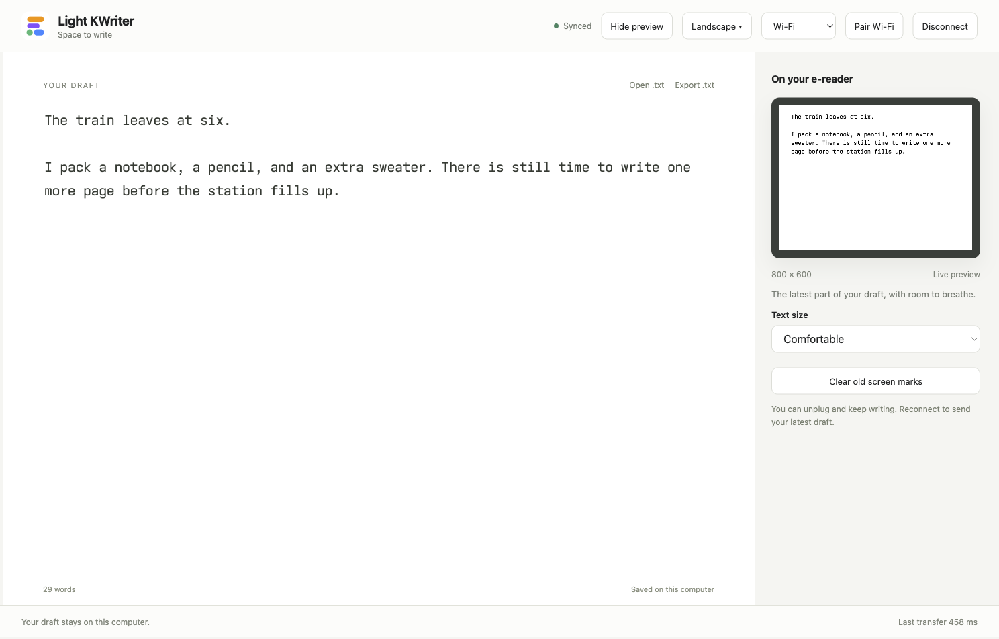
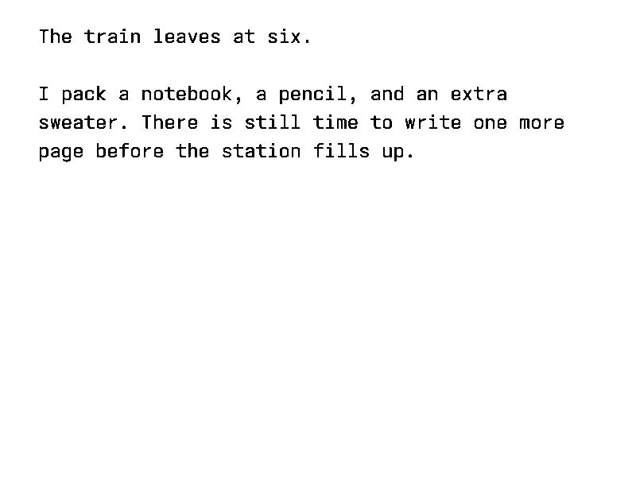

# Light KWriter

A local writing page with a live e-ink view.

## What you need

- macOS or Linux, Python 3.9 or newer, and the `ssh` command.
- A modern browser. No JavaScript packages or build step are needed.
- A jailbroken Kindle with USBNetwork and NiLuJe's FBInk tools installed.
- For wireless use, the computer and Kindle must join the same local Wi-Fi network.

Tested hardware: silver Kindle 4 Non-Touch, firmware 4.1.4. This release uses a 600 × 800 screen. Other models need an adapter; see [Adapting the app](docs/ADAPTING.md). Windows helpers have not been tested and the current helper uses Unix terminal APIs.

## Start

1. Download or clone this repo.
2. On a Mac, open `Launch.command`. You can also run `python3 server.py --open` in this folder.
3. The page opens in your browser. Keep the helper running while you use it.

The page and helper run on your computer. There is no account, cloud service, or public server.

## Connect with USB

Enable USBNetwork on the Kindle, then connect it to the computer. Choose **USB cable** and **Connect Kindle** in the app.

The default adapter expects the usual Kindle 4 USBNetwork address. Your computer must already have a working USBNetwork connection. On first use, it trusts the host key seen over that physical USB link. Later connections check that key.

## Connect with Wi-Fi

1. Join Wi-Fi on the Kindle.
2. Connect it once with USBNetwork enabled.
3. Click **Pair Wi-Fi**. Nothing needs to be typed on the Kindle.
4. Once paired, choose **Wi-Fi**. You can remove the cable.

Pairing creates a local device key in the app's private data folder and installs its public part on your Kindle. It starts a separate, password-disabled Wi-Fi connection on port 2222. It leaves the existing USB login in place. No credentials are shown or sent to a cloud service.

If the Kindle's address changes, the helper searches the paired IPv4 subnet and checks the device's saved host key before connecting. Discovery does not scan other networks. After a Kindle reboot, open **KUAL → E-reader Wi-Fi → Start secure Wi-Fi connection**. If you move to a different network, pair over USB again.

Use only one app to control the Kindle screen at a time. Disconnect one before connecting the other.

## Write

Type in the editor. Selection, copy, paste, and undo use the browser's normal text controls. **Open .txt** loads a text file; **Export .txt** saves a copy.

Your draft is saved in this browser and by the local helper. You can disconnect and keep writing. Reconnect to send the latest draft. The e-reader shows the last lines that fit, while the computer keeps the full document.

Use **Show preview** to open the screen preview. Choose a text size, or use **Orientation** to put the cable on any side. The text reflows to fit. **Clear old screen marks** requests a full refresh.

The preview supplies the same black-and-white pixels sent to the Kindle. Screen contrast, camera angle, and e-ink ghosting can still differ.

Your data is stored in `~/Library/Application Support/light-kwriter` on macOS, or `~/.local/share/light-kwriter` on Linux. `EINK_DATA_DIR` can choose another folder. Back up `data.json` to keep a copy of your draft.

## Screenshots

The browser screenshots use sample text. Device screenshots come directly from the Kindle framebuffer.

## Development

See [AGENTS.md](AGENTS.md) for the file map and checks. See [device tests](docs/TESTING.md) for what was checked on real hardware. The app icon was selected from AI-generated concepts. No Amazon fonts, firmware, or jailbreak files are included.

The writing font is [Ioskeley Mono](https://github.com/ahatem/IoskeleyMono), included under the SIL Open Font License in `web/fonts/LICENSE`.
